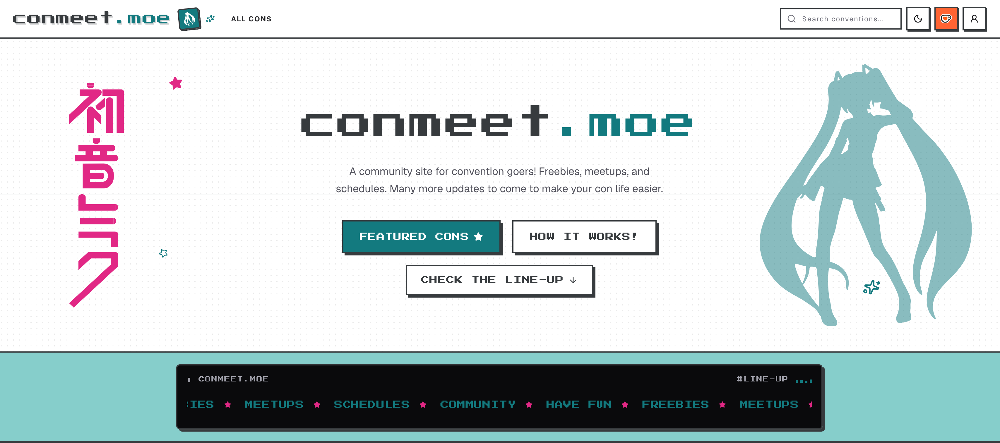

<!-- Improved compatibility of back to top link: See: https://github.com/othneildrew/Best-README-Template/pull/73 -->
<a id="readme-top"></a>

<!-- PROJECT LOGO -->
<br />
<div align="center">
  <h1 align="center">conmeet.moe</h1>
  <p align="center">
    A community site for convention goers!
  </p>
  <br />
  
</div>

<br />

<!-- TABLE OF CONTENTS -->
<details>
  <summary>Table of Contents</summary>
  <ol>
    <li>
      <a href="#about-the-project">About The Project</a>
      <ul>
        <li><a href="#freebies">Freebies</a></li>
        <li><a href="#meetups">Meetups</a></li>
        <li><a href="#artists">Artists</a></li>
        <li><a href="#schedule">Schedule</a></li>
      </ul>
    </li>
    <li><a href="#built-with">Built With</a></li>
    <li>
      <a href="#getting-started">Getting Started</a>
      <ul>
        <li><a href="#prerequisites">Prerequisites</a></li>
        <li><a href="#installation">Installation</a></li>
      </ul>
    </li>
    <li><a href="#roadmap">Roadmap</a></li>
    <li><a href="#license">License</a></li>
    <li><a href="#contact">Contact</a></li>
  </ol>
</details>

<!-- ABOUT THE PROJECT -->
## About The Project

I've had this idea for a project for a while now after going to conventions. At AnimeNYC I had a hard time trying to find the booths, meetups, artists, and freebies that I wanted to visit lol. It is still fun but I think this site could make it easier for others at convention and even after it has ended.

### Freebies 
I love freebies lol. There are usually a good amount of them and some people post lists on reddit. Gacha games usually give a lot and I play them so... Arknights Endfield gave the best at AnimeNYC 2026. The bag was also great. Anyways, I wanted a section that others could share freebies by posting and also be able to save them. The issue is finding the freebies which if there is a map then each freebie could have a link to the place on the map. If there isn't a map it does make things harder but I think a user could take a picture of the booth so it might be easier to find. 

### Meetups
Meetups to me are the easiest to plan and go to but I think that there could be a place for before and after the meetups. What I mean is that before a meetup, you could find others who are also going to the meetup and comment with each other. I would guess most would just share socials with each other (probably will add something in settings so users can just hover over the name and get a popup of a users profile with info of socials, etc). After a meetup, people can share the photos they took in an album of their own in the collections page. The problem is storage I guess but I don't expect a lot of users? (unless it does become popular lol). Official or even unofficial meetups can be added (can't be more than 1 official). Also if I add in a schedule feature then users can add meetups to their schedule. 

### Artists
A lot of my favorite artists sell at conventions but keeping track of where they are located is a bit hard to do. Having to take a screenshot of the post they put and trying to find the exact booth in artist alley got tedious. I think they could benefit a lot from an interactive map where you could find and save their location. If there isn't a map to use, I think that it would still be useful to have a section where artists can post that they are going to the conventions with an attached images of their booth, what they are selling, links to social, etc. 

### Schedule 
Just a normal schedule planner thingy. Official meets, events, etc. 

<p align="right">(<a href="#readme-top">back to top</a>)</p>

<!-- BUILT WITH -->
## Built With

### Frontend
* [](https://nextjs.org/)
* [](https://react.dev/)
* [](https://www.typescriptlang.org/)
* [](https://tailwindcss.com/)
* [](https://tanstack.com/query)
* [](https://lucide.dev/)

### Backend & Infrastructure
* [](https://www.python.org/)
* [](https://www.djangoproject.com/)
* [](https://www.django-rest-framework.org/)
* [](https://github.com/unfoldadmin/django-unfold)
* [](https://docs.astral.sh/uv/)
* [](https://www.postgresql.org/)
* [](https://redis.io/)
* [](https://www.docker.com/)

<p align="right">(<a href="#readme-top">back to top</a>)</p>

<!-- GETTING STARTED -->
## Getting Started

To get a local development copy up and running, follow these steps.

### Prerequisites

Ensure you have the following installed on your machine:
* **Node.js** (v20+ recommended) & **npm**
* **Python** (3.14+) & **[uv](https://docs.astral.sh/uv/)** (fast Python package and project manager)
* **Docker & Docker Compose** (for running PostgreSQL and Redis services)

### Installation

1. **Clone the repository**
   ```sh
   git clone https://github.com/koszys/conmeet.moe.git
   cd conmeet.moe
   ```

2. **Start database and Redis services with Docker**
   ```sh
   docker compose up -d
   ```
   *This starts PostgreSQL on port `5433`, Redis on port `6379`, and pgAdmin on port `5050`.*

3. **Setup and start the Backend**
   ```sh
   cd backend

   # Install dependencies with uv
   uv sync

   # Configure environment variables
   cp .env.example .env

   # Run database migrations
   uv run python manage.py migrate

   # (Optional) Create a superuser for admin access
   uv run python manage.py createsuperuser

   # Start the backend server
   uv run python manage.py runserver 0.0.0.0:8000
   ```
   *The backend API will run at [http://localhost:8000](http://localhost:8000) and the Django Unfold admin panel at [http://localhost:8000/admin/](http://localhost:8000/admin/).*

4. **Setup and start the Frontend**
   In a separate terminal window:
   ```sh
   cd frontend

   # Install npm packages
   npm install

   # Start the Next.js development server
   npm run dev
   ```
   *The web application will be live at [http://localhost:3000](http://localhost:3000).*

<p align="right">(<a href="#readme-top">back to top</a>)</p>

<!-- ROADMAP -->
## Roadmap
- [x] Landing page and convention lists
- [x] Convention pages
- [x] Freebies feature
- [ ] Convention map feature
- [ ] Meetups feature
- [ ] Artist Alley feature
- [ ] Personal convention schedule planner
- [ ] More stuff / QOL !

See the [open issues](https://github.com/koszys/conmeet.moe/issues) for a full list of proposed features (and known issues).

<p align="right">(<a href="#readme-top">back to top</a>)</p>

<!-- LICENSE -->
## License

Distributed under the MIT License. See `LICENSE` for more information.

<p align="right">(<a href="#readme-top">back to top</a>)</p>

<!-- CONTACT -->
## Contact

koszy - [@koszys](https://github.com/koszys)

Project Link: [https://github.com/koszys/conmeet.moe](https://github.com/koszys/conmeet.moe)

<p align="right">(<a href="#readme-top">back to top</a>)</p>
